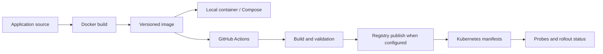

<div align="center">


### Build once · Scan the artifact · Deploy deliberately

[](https://docs.docker.com/)
[](https://nginx.org/)
[](https://docs.github.com/actions)
[](https://kubernetes.io/)

**A practical container delivery example: package a web application, run it locally, validate the image workflow and deploy to Kubernetes only through an explicitly configured path.**

[Architecture](#-delivery-architecture) · [Run locally](#-run-locally) · [Kubernetes](#-kubernetes-deployment) · [Security](#-container-security)

</div>

## Project overview

This repository demonstrates the path from application source to a container image and a Kubernetes workload. It is intentionally small enough to run locally while exposing the engineering controls that matter in a delivery pipeline.

## Delivery architecture



## What is in this repository

| Path | Purpose |
|---|---|
| `app/` | Static web application |
| `Dockerfile` | Nginx-based container image |
| Compose file | Local multi-container workflow, if configured |
| `.github/workflows/` | Build, validation and deployment workflows |
| `kubernetes/` | Kubernetes workload and service manifests |
| `docs/kubernetes-deployment.md` | Manual cluster deployment guide |

## Run locally

### Requirements

- Docker Engine with Docker CLI.
- Docker Compose plugin if you want to use Compose.
- Git to clone the repository.

### Build

```bash
docker build -t dockerized-application-devops:local .
```

### Run

```bash
docker run --rm --name devops-web -p 8080:80 dockerized-application-devops:local
```

Open [http://localhost:8080](http://localhost:8080). Stop the container with `Ctrl+C`.

If the Compose file is present and configured:

```bash
docker compose config
docker compose up --build
```

Stop the stack with:

```bash
docker compose down
```

## Kubernetes deployment

The manifests are designed around a hardened baseline: non-root execution, read-only root filesystem, dropped Linux capabilities, resource controls, health probes and an internal `ClusterIP` Service.

- The manifest-validation workflow checks YAML/basic structure without needing cluster credentials.
- The manual deployment workflow requires a configured GitHub environment secret named `KUBE_CONFIG_DATA` and explicit confirmation.
- The workflow performs a server-side dry-run, applies manifests and waits for rollout.
- The deployment guide is [docs/kubernetes-deployment.md](docs/kubernetes-deployment.md).

A live cluster deployment is **not** claimed until a test cluster is configured and a manual workflow run succeeds. The default `ClusterIP` service does not create a public cloud load balancer.

## Container security

- Pin the Nginx base image to a reviewed version or digest before a controlled release.
- Scan the built image and define a severity policy before publishing.
- Use immutable commit-SHA tags; do not treat mutable tags as artifact identity.
- Keep registry and cluster credentials in protected GitHub environments or use short-lived identity where supported.
- Do not expose deployment secrets to untrusted pull-request workflows.
- Review container user, filesystem permissions, capabilities and resource limits whenever the base image changes.

## CI/CD verification

Check the repository's [Actions history](../../actions) for current workflow runs. A successful image build proves that the image was built; it does not prove the image was deployed, exposed securely or observed in a live cluster.

## Next engineering steps

- [ ] Pin base image by digest and enable image scanning.
- [ ] Publish immutable artifacts to a registry using least-privilege credentials.
- [ ] Add automated application smoke tests.
- [ ] Validate Kubernetes manifests against a target cluster version.
- [ ] Capture a genuine deployment screenshot and rollout evidence.
- [ ] Add monitoring, alerting and a rollback runbook.

## Documentation

- [Manual Kubernetes deployment](docs/kubernetes-deployment.md)
- [Architecture and interview guide](docs/README.md)
- [Zero-to-hero walkthrough](docs/ZERO-TO-HERO.md)
- [Advanced interview scenarios](docs/ADVANCED-INTERVIEW-BANK.md)

## Maintainer

**MD Amirul Haque** · [GitHub](https://github.com/haqueamir70-coder) · [LinkedIn](https://www.linkedin.com/in/md-amirul-haque/)

<sub>Reproducible builds. Hardened workloads. Controlled releases.</sub>
