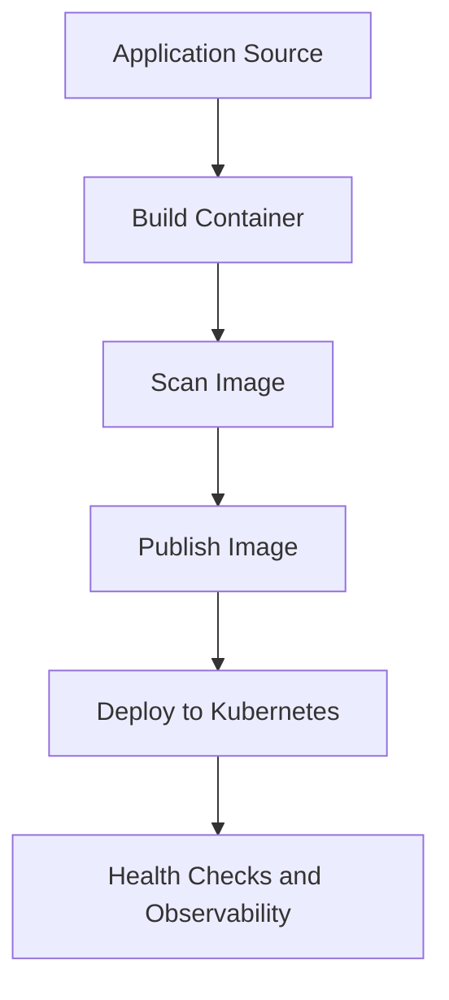

<div align="center">


[](https://developer.hashicorp.com/terraform)
[](https://azure.microsoft.com/)
[](https://github.com/haqueamir70-coder)

</div>

> **Portfolio project:** implementation status and limitations are documented below. The diagram describes the intended workflow/architecture and is not proof of a successful production deployment.

## 🗺️ Architecture at a Glance



---

# Dockerized Application DevOps

A portfolio project demonstrating a simple web application packaged with Docker, with repository configuration for a GitHub Actions image workflow and Kubernetes manifests.

## What this repository contains

- A sample static web application under `app/`
- A Dockerfile based on Nginx
- Docker Compose configuration for local execution
- GitHub Actions workflow files under `.github/workflows/`
- Kubernetes deployment configuration (inspect `kubernetes/` for the current manifests)

The README describes the intended workflow; verify the actual workflow run and cluster deployment before treating a stage as operationally proven.

## Architecture

```text
Code change
    |
    v
GitHub repository
    |
    v
GitHub Actions workflow
    |
    v
Build container image
    |
    v
Container registry
    |
    v
Kubernetes deployment (when configured)
```

## Technology stack

- Docker and Docker Compose
- Nginx
- GitHub Actions
- Kubernetes YAML
- Git and GitHub

## Run locally

Build the image from the repository root:

```bash
docker build -t dockerized-application-devops:local .
```

Run it on port 8080:

```bash
docker run --rm -p 8080:80 dockerized-application-devops:local
```

Open `http://localhost:8080`.

If Docker Compose is configured for your environment, you can also inspect and run it with:

```bash
docker compose config
docker compose up --build
```

Stop the Compose application with `Ctrl+C`, then run `docker compose down` if needed.

## CI/CD workflow

Inspect `.github/workflows/` to confirm the current trigger, image tags, registry login, and push behavior. For registry publishing:

- Store credentials only in GitHub Actions secrets, or use a supported short-lived identity mechanism.
- Never hard-code credentials in YAML or application files.
- Prefer immutable image tags (for example, a commit SHA) in addition to any human-readable tag.
- Pin third-party Actions to reviewed versions or commit SHAs.
- Configure least-privilege permissions and avoid publishing images from untrusted pull requests.

## Kubernetes

The manifests use a non-root Nginx container, read-only root filesystem, dropped Linux capabilities, resource limits, health probes, and an internal `ClusterIP` Service by default.

- **Manifest validation:** `.github/workflows/kubernetes-deploy.yml` checks YAML/basic structure without requiring cluster credentials.
- **Manual cluster deployment:** `.github/workflows/kubernetes-manual-deploy.yml` requires a configured GitHub environment secret named `KUBE_CONFIG_DATA` and explicit confirmation. It performs server-side dry-run, applies the manifests, and waits for rollout.
- **Setup instructions:** see [docs/kubernetes-deployment.md](docs/kubernetes-deployment.md).

A real deployment is not claimed until a test cluster and least-privilege credentials are configured and a manual deployment run succeeds. The default ClusterIP Service avoids creating a public cloud load balancer automatically.

## Production-readiness checklist

- [ ] Use a pinned base image version and scan the resulting image.
- [ ] Run the container as a non-root user where feasible.
- [ ] Add health checks, resource requests/limits, and security context to Kubernetes manifests.
- [ ] Add automated tests and workflow status checks.
- [ ] Use protected deployment environments and least-privilege credentials.
- [ ] Document rollback, image retention, monitoring, and cleanup.
- [ ] Confirm successful CI runs and a real test deployment before claiming production readiness.

## Author

MD Amirul Haque · [GitHub profile](https://github.com/haqueamir70-coder) · [LinkedIn](https://www.linkedin.com/in/md-amirul-haque/)
