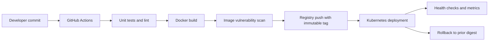

# Dockerized application delivery — Architecture & Interview Guide

Container delivery reference from source code through image build, scan and deployment manifest. Confirm the exact application entry point and cluster runtime before claiming a live deployment.

## Architecture diagram

## Interview questions

1. 1. What is the difference between an image and a container?
2. 2. How do multi-stage Docker builds reduce attack surface?
3. 3. Why should containers run as non-root?
4. 4. How do you manage image tags and immutable digests?
5. 5. How do Docker layer caching and build context affect CI speed?
6. 6. How do you scan images for vulnerabilities and secrets?
7. 7. What are readiness, liveness and startup probes?
8. 8. How do Kubernetes rolling updates and rollbacks work?
9. 9. How would you inject secrets without baking them into an image?
10. 10. What metrics and logs would you use to troubleshoot a failing container?

## Interview preparation note
For each answer, cover the design rationale, trust boundary, failure mode, operational telemetry and validation method. Distinguish implemented, CI-validated, cloud-deployed and planned capabilities.
