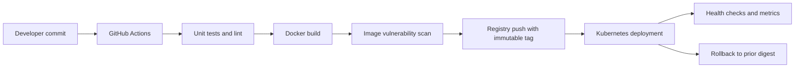

# Dockerized application delivery — Architecture & Interview Guide

Container delivery reference from source code through image build, scan and deployment manifest. Confirm the exact application entry point and cluster runtime before claiming a live deployment.

## Architecture diagram

## Interview questions

1. 1. What is the difference between an image and a container?
2. 2. How do multi-stage Docker builds reduce attack surface?
3. 3. Why should containers run as non-root?
4. 4. How do you manage image tags and immutable digests?
5. 5. How do Docker layer caching and build context affect CI speed?
6. 6. How do you scan images for vulnerabilities and secrets?
7. 7. What are readiness, liveness and startup probes?
8. 8. How do Kubernetes rolling updates and rollbacks work?
9. 9. How would you inject secrets without baking them into an image?
10. 10. What metrics and logs would you use to troubleshoot a failing container?

## Interview preparation note
For each answer, cover the design rationale, trust boundary, failure mode, operational telemetry and validation method. Distinguish implemented, CI-validated, cloud-deployed and planned capabilities.

## Interview questions — suggested answers

### 1. Answer

An image is an immutable template of filesystem/configuration layers; a container is a running isolated process created from an image.

### 2. Answer

Multi-stage builds separate compilation/build dependencies from the runtime image, reducing image size and removing unnecessary tools and packages.

### 3. Answer

Non-root execution limits what an attacker can do after compromising the process. Combine it with read-only filesystem, dropped capabilities and seccomp where feasible.

### 4. Answer

Tags are human-friendly but mutable; pin deployments to digests for reproducibility and integrity. Publish version tags for discoverability, then deploy verified digests.

### 5. Answer

Layer caching reuses unchanged build steps; a small .dockerignore and stable dependency layers reduce upload and rebuild time.

### 6. Answer

Scan source and image for vulnerabilities and secrets, generate an SBOM, set severity policy and document exceptions. Avoid treating an informational exit code as a blocking gate.

### 7. Answer

Readiness decides whether traffic should be sent, liveness restarts a stuck container, and startup gives slow-starting applications time before other probes apply.

### 8. Answer

Rolling updates gradually replace pods; rollback restores a previous ReplicaSet/revision or GitOps desired state. Monitor availability during rollout.

### 9. Answer

Use Kubernetes Secrets integrated with a secret manager/CSI or external secrets operator, workload identity and restricted RBAC. Never bake credentials into image layers.

### 10. Answer

Inspect pod events, logs, exit codes, resource usage, probe failures, image pull events and service endpoints; correlate with node pressure and recent deployments.

## Complete zero-to-hero guide

See [ZERO-TO-HERO.md](./ZERO-TO-HERO.md) for the business scenario, architecture walkthrough, tool-by-tool explanations, implementation sequence, practical commands, troubleshooting playbook and additional scenario-based interview questions with answers.
