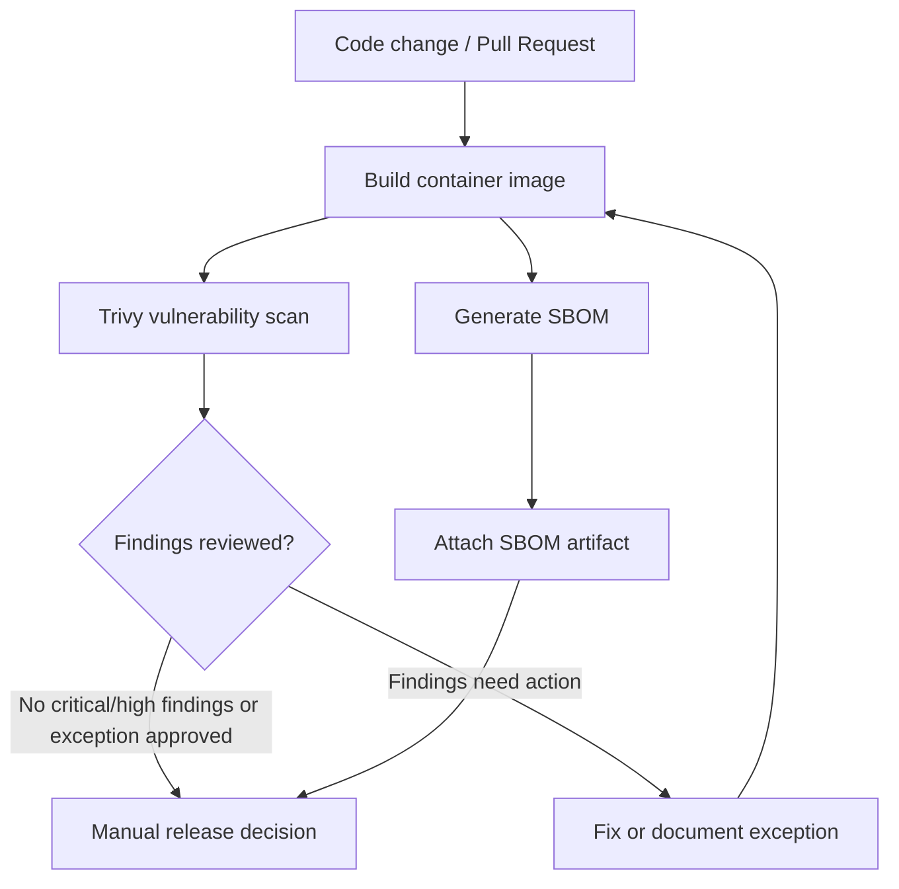

<div align="center">


[](https://docs.docker.com/)
[](https://docs.github.com/actions)
[](https://trivy.dev/)

</div>

# Secure Container Supply Chain

A hands-on portfolio lab demonstrating how to add container security checks to a CI workflow. This project focuses on building an image, scanning for known vulnerabilities, generating a software bill of materials (SBOM), and reviewing results before release.

## Architecture



## Goals

- Add an image vulnerability scan to pull-request CI.
- Generate an SBOM as a build artifact.
- Keep workflow permissions minimal.
- Fail the security step on configured severity thresholds.
- Make findings visible for review rather than silently suppressing them.

## Included workflow

The parent repository's `.github/workflows/container-security.yml` is designed to build the repository's Docker image, run Trivy, and publish an SBOM artifact for review. Check the Actions tab for the latest run and read the workflow file to confirm the exact behavior.

## Run locally

From the parent repository root:

```bash
docker build -t secure-container-supply-chain:local .
docker run --rm -p 8080:80 secure-container-supply-chain:local
```

Scan locally if Trivy is installed:

```bash
trivy image --severity HIGH,CRITICAL secure-container-supply-chain:local
```

## Security notes

- Vulnerability scanners can produce false positives and do not prove an image is safe.
- Review base-image freshness, application dependencies, and the actual fix availability.
- Avoid placing credentials in Docker build arguments or image layers.
- For a real release pipeline, pin third-party Actions to reviewed immutable commit SHAs and use image digests for deployment.
- This is a portfolio lab, not a certified compliance control or a production security guarantee.

## Evidence checklist

- [ ] Successful workflow run on the default branch
- [ ] Reviewed Trivy output
- [ ] SBOM artifact generated and inspected
- [ ] Documented any accepted vulnerabilities and compensating controls
- [ ] Re-run after fixing findings
